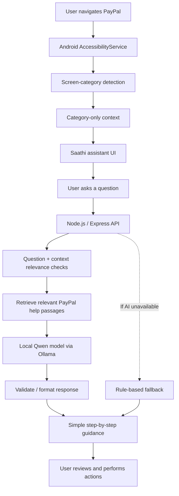

<div align="center">

# PayPal Saathi AI 🤝

### A voice-friendly, context-aware digital payments companion for beginners.

**Helping people understand what to do next — without taking control of their payments.**

[](https://developer.android.com/)
[](https://www.java.com/)
[](https://nodejs.org/)
[](https://expressjs.com/)
[](https://ollama.com/)

**[View repository](https://github.com/vinut-hna-coder-6057/paypal-saathi-ai)**

</div>

---

## The problem

Digital payment apps can be intimidating for people who are new to smartphones, online payments, or app navigation. A user may not know what a screen means, which step to take next, or how to recover when they get stuck.

Traditional help pages require users to leave the current screen, search for instructions, and translate technical language into actions.

**PayPal Saathi AI explores a more contextual approach:** an Android companion that can identify a supported PayPal screen category and explain the next steps in simple language, while leaving every sensitive action and payment decision under the user's control.

## Product principles

- **Guide, don't act:** explain steps; do not initiate or approve payments on the user's behalf.
- **Context-aware, question-aware:** use the detected screen as context, but answer the question the user actually asked.
- **Privacy first:** avoid collecting or transmitting raw screen text, passwords, OTPs, card details, or payment credentials.
- **Accessible by design:** aim for clear wording, simple instructions, and a low-friction assistance flow.
- **Graceful degradation:** retain deterministic guidance and offline fallback behavior when the AI service is unavailable.

## How it works



## Core capabilities

### 📱 Android companion

- Native Android application built with Java and XML layouts.
- Accessibility-based detection for supported PayPal screen categories.
- Floating assistant experience for requesting help while navigating.
- Guidance screen with detected category/status and a way to refresh guidance.
- “Ask Saathi” interaction for user questions.
- Network/API client with loading, error, retry, and offline fallback states.
- Event cooldown/debounce behavior to reduce repeated screen-triggered requests.

### 🧠 Retrieval-augmented guidance

The project includes a local RAG pipeline intended to ground answers in relevant help content rather than rely only on a model's general knowledge.

- Help-document ingestion and chunking.
- Text embeddings using `Xenova/all-MiniLM-L6-v2` through Transformers.js.
- SQLite-backed storage for retrieved knowledge.
- Similarity-based retrieval of relevant passages.
- Local language-model inference through Ollama using `qwen2.5:3b-instruct`.
- Question-relevance handling so the user's question remains central, with screen category acting as supporting context.
- Rule-based guidance fallback when the AI path is unavailable.

The current documented knowledge base includes a small set of official PayPal India help articles. Its coverage is therefore bounded by the ingested material; it should not be treated as a complete source of PayPal policy or account-specific information.

### 🔌 Backend API

The Node.js/Express backend provides the service boundary between the Android app and guidance logic. Implemented endpoint areas include:

- `GET /health` — service health check.
- `POST /api/classify` — supported screen/question classification workflow.
- `POST /api/guidance` — guidance response workflow.

The backend includes request validation and security-oriented middleware. Check the source and local configuration for the exact request schemas, environment variables, and port used by your checkout.

### 🛡️ Safety and privacy boundaries

- The assistant is a guide, not a payment executor.
- Password fields are excluded from screen-context processing.
- The design favors category-level context instead of uploading raw screen content.
- Model output should be treated as guidance, not as authoritative account-specific financial advice.
- Users should never share passwords, OTPs, PINs, full card numbers, or recovery codes with the assistant.
- A production release should use HTTPS, explicit permission explanations, strict origin/network configuration, and tested data-minimization rules.

---

## Architecture

| Component | Technology | Responsibility |
|---|---|---|
| Android app | Java, XML | Native UI and user interaction |
| Screen awareness | Android AccessibilityService | Detect supported app/screen context within configured scope |
| Floating assistant | Android overlay/UI components | Provide an entry point to ask for help |
| Backend | Node.js, Express | API boundary, validation, classification, and guidance orchestration |
| Retrieval | Transformers.js, `Xenova/all-MiniLM-L6-v2` | Embed text for semantic retrieval |
| Knowledge store | SQLite | Store ingested passages and retrieval data |
| Local inference | Ollama, `qwen2.5:3b-instruct` | Generate a response grounded by retrieved context |
| Fallback path | Rule-based guidance | Provide deterministic help when the AI path is unavailable |

## Repository structure

The exact layout can evolve; use the current repository as the source of truth.

```text
paypal-saathi-ai/
├── android/              # Native Android app (Java/XML)
├── backend/              # Node.js / Express API and guidance logic
├── docs/                 # Architecture, privacy, and model notes
├── README.md
└── .gitignore
```

---

## Getting started

### Prerequisites

- JDK 21
- Android Studio and Android SDK
- Android device or emulator
- Node.js 20+ and npm
- Ollama, if running the local model-backed guidance path

> **Configuration note:** Check the repository's current Gradle files, backend package scripts, `.env.example` (if present), and documentation for exact module paths, commands, environment variable names, and port numbers. Do not commit local `.env` files, signing keys, API credentials, or private account data.

### 1. Clone the repository

```bash
git clone https://github.com/vinut-hna-coder-6057/paypal-saathi-ai.git
cd paypal-saathi-ai
```

### 2. Start the backend

Move into the backend directory and install dependencies:

```bash
cd backend
npm install
```

Configure the backend using the environment settings documented by the project. Start it using the repository's defined script, for example:

```bash
npm run dev
```

If that script is not defined in your current checkout, inspect `package.json` and use the listed start script. Confirm the configured port before launching; another local process may already be using it.

### 3. Configure local model inference

Install and start Ollama, then pull the model used by the project:

```bash
ollama pull qwen2.5:3b-instruct
ollama run qwen2.5:3b-instruct
```

The backend must be configured to reach the local Ollama service. A physical Android phone cannot use its own `localhost` to reach a backend running on your computer; configure a reachable development-machine address for device testing.

### 4. Build and run Android

Open the Android project in Android Studio, allow Gradle sync to complete, and run it on an emulator or connected device.

To build a debug APK, use the Gradle wrapper from the Android project root (adjust the path to match the repository):

```powershell
.\gradlew.bat assembleDebug
```

The resulting APK is typically under the relevant module's `build/outputs/apk/debug/` directory. Use the actual build output path reported by Gradle.

### 5. Enable accessibility only after reviewing the explanation

Android Accessibility access is powerful. Enable the service only after reviewing the app's explanation of what it reads, when it operates, and what context is sent to the backend. Test with a non-sensitive account/screen and verify that passwords, OTPs, and payment credentials are not captured or transmitted.

---

## Testing and validation

The project has an automated backend test foundation, and prior development checks reported 35 passing backend tests. Re-run the current suite after changes; historical results do not guarantee the current checkout passes.

Recommended checks before sharing a build:

- [ ] Backend tests pass from a clean install.
- [ ] `/health`, `/api/classify`, and `/api/guidance` behave as documented.
- [ ] Relevant questions are answered based on the question, not just the detected screen category.
- [ ] AI timeout, model unavailable, empty retrieval, and malformed input paths are handled.
- [ ] Screen detection and the floating assistant work on the target physical device.
- [ ] Password and sensitive-field exclusion is tested.
- [ ] Logs and API requests do not contain secrets or unnecessary raw screen text.
- [ ] Network errors show a clear retry/fallback path.
- [ ] Release signing, permissions, network security, and privacy disclosures are reviewed.

## Current scope and limitations

PayPal Saathi AI is an evolving project, not a claim of an officially endorsed PayPal product.

- It is an independent companion concept and is **not affiliated with or endorsed by PayPal**.
- Guidance quality is limited by the coverage and freshness of the ingested help documents and by model behavior.
- The local model path may have noticeable cold-start latency on modest hardware.
- Accessibility behavior and overlay support vary by Android version, device, and target app; physical-device validation matters.
- The current RAG corpus is small and does not provide access to a user's private PayPal account state.
- Production deployment, comprehensive device coverage, and independent security/privacy review should be completed before broad distribution.

## Roadmap

Potential improvements — not claims that these are already implemented:

- [ ] Expand the reviewed, versioned knowledge base using official help sources.
- [ ] Add evaluation cases for relevance, grounding, refusal, and sensitive-data handling.
- [ ] Improve latency measurement and model lifecycle management.
- [ ] Add structured observability without logging sensitive content.
- [ ] Complete accessibility and usability testing with digital-payment beginners.
- [ ] Harden release configuration, network security, and privacy documentation.
- [ ] Add a repeatable physical-device test matrix across Android versions.

## Why this project matters

PayPal Saathi AI brings together several practical engineering problems:

- Android accessibility and lifecycle behavior.
- A mobile-to-backend API boundary.
- Context classification and deterministic fallback logic.
- Embedding-based retrieval and local LLM orchestration.
- Latency, privacy, and relevance trade-offs in AI-assisted products.
- Clear safety boundaries for a sensitive digital-payment workflow.

The goal is not to automate financial decisions. It is to make digital interfaces easier to understand while keeping the user in control.

## Author

**Vinuthna** — Computer Science (AI & ML) undergraduate interested in full-stack engineering, backend systems, and responsible AI.

- GitHub: [@vinut-hna-coder-6057](https://github.com/vinut-hna-coder-6057)
- Project repository: [PayPal Saathi AI](https://github.com/vinut-hna-coder-6057/paypal-saathi-ai)

---

<div align="center">

**PayPal Saathi AI — clearer guidance, safer interactions, user stays in control.**

</div>
